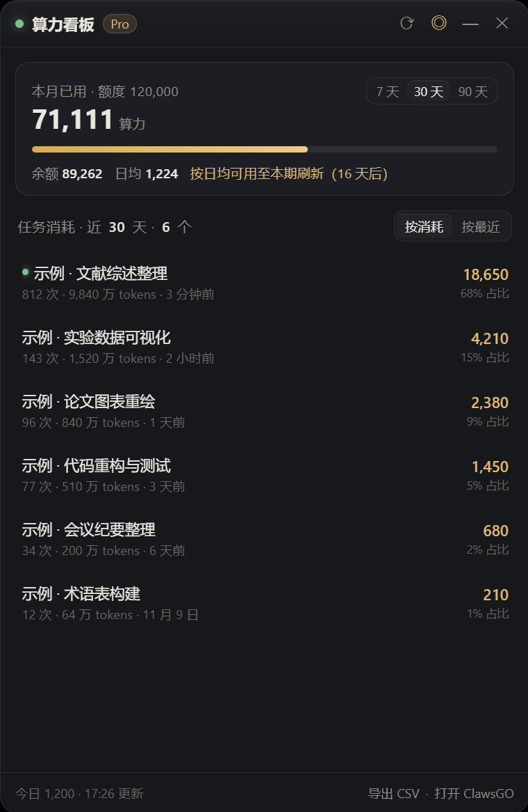
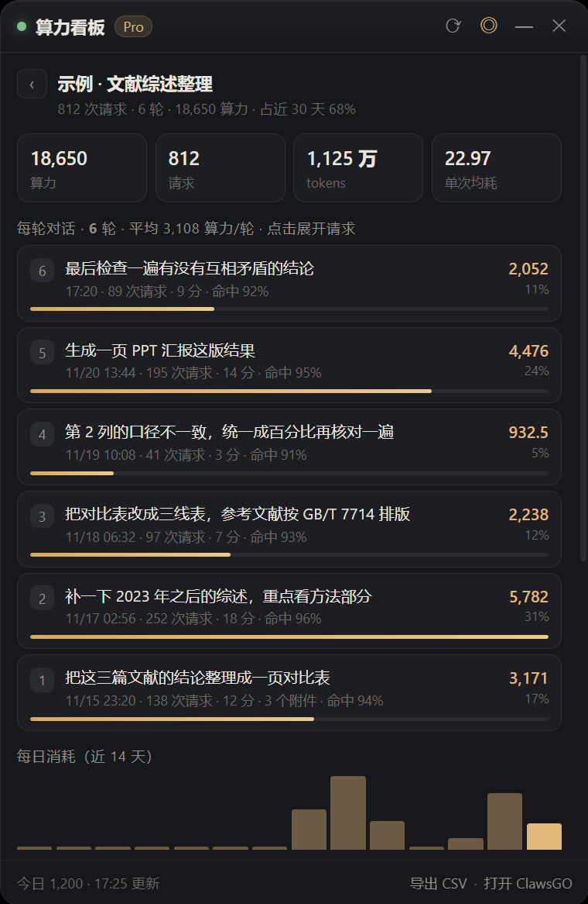

# ClawsGO 算力看板

> 一个常驻桌面的小看板：把 ClawsGO 里每个任务、每一轮对话消耗的算力拆开显示出来。仅支持 Windows。

ClawsGO 的用量页只有一条条流水——几点了、扣了多少。但看不出这些算力具体是哪件事、哪一轮对话烧的，也就很难判断某个任务值不值这个价、这个月还要不要继续充。

这个看板把扣费按「任务」和「轮次」重新聚合，跟在 ClawsGO 窗口旁边，随用随看。



## 显示什么

- 本月已用 / 额度、余额、最近 7 天日均，以及按这个速度还能用到什么时候
- 任务排行：近 7 / 30 / 90 天里每个任务花了多少算力、多少次请求、多少 tokens
- 每轮对话：一条消息加它的回复算一轮，显示这一轮的算力、请求数、耗时、缓存命中率；点开能看到这一轮里的每一次请求
- 只在 ClawsGO 是当前窗口时出现，切到别的软件会自动隐藏，不遮挡其他应用



## 运行

需要 Windows 和 Node.js 20 以上。

```bash
npm install
npm start
```

也可以双击 `start.cmd` 启动；不想要控制台窗口就用 `start-hidden.vbs`。

第一次使用前先在 ClawsGO 里登录，看板会读取本机的登录状态。想先看看界面，可以跑演示模式（内置假数据，不需要账号）：

```bash
npm run demo
```

命令行报告：

```bash
node tools/report.cjs --days 7 --top 20
```

托盘菜单里可以关闭「跟随 ClawsGO」、设置开机自启、导出 CSV。

## 数据来源

- **登录态**：读取本机 ClawsGO 的 Chromium localStorage（`%APPDATA%\ClawsGO\<profile>\Local Storage`），
  token 只在内存中使用，不写入磁盘。
- **接口**：`getSubscription`、`getUsageStats`、`getCreditLedger`、`getMessages`，全部只读，
  请求直接发往 `api.clawsgo.cn`，不经过任何第三方。
- **每轮的 tokens** 来自消息的 `metadata.usage`；**每轮的算力** 是把扣费流水按这一轮的时间窗口归并得出。
- 单位：接口返回 `amountMilli`，界面里除以 1000，和 ClawsGO 显示的「-42.5」这类数字一致。

看板不修改 ClawsGO 的任何文件，也不会上传你的使用数据。

## 目录结构

```
main.cjs          窗口、托盘、跟随逻辑、数据刷新
preload.cjs       安全的 IPC 桥
lib/token.cjs     读取本机 ClawsGO 登录态
lib/api.cjs       只读接口封装
lib/winwatch.cjs  Win32 窗口探测（koffi），用于跟随 ClawsGO
lib/demo.cjs      --demo 演示数据
renderer/         界面（原生 HTML / CSS / JS，无框架）
```

## 已知限制

- 只支持 Windows：跟随窗口用的是 Win32 API
- 只读取 ClawsGO 当前选中的团队
- ClawsGO 调整接口时需要同步修改 `lib/api.cjs`
- 轮次归并依赖消息记录；如果任务已被删除，只能退化成按时间间隔粗略分组

## 免责声明

这是一个第三方工具，与 ClawsGO 官方没有任何关系。使用前请自行确认符合其服务条款；
因使用本工具产生的任何问题由使用者自行承担。

## License

MIT

本项目由 DeepSeek 制作。
